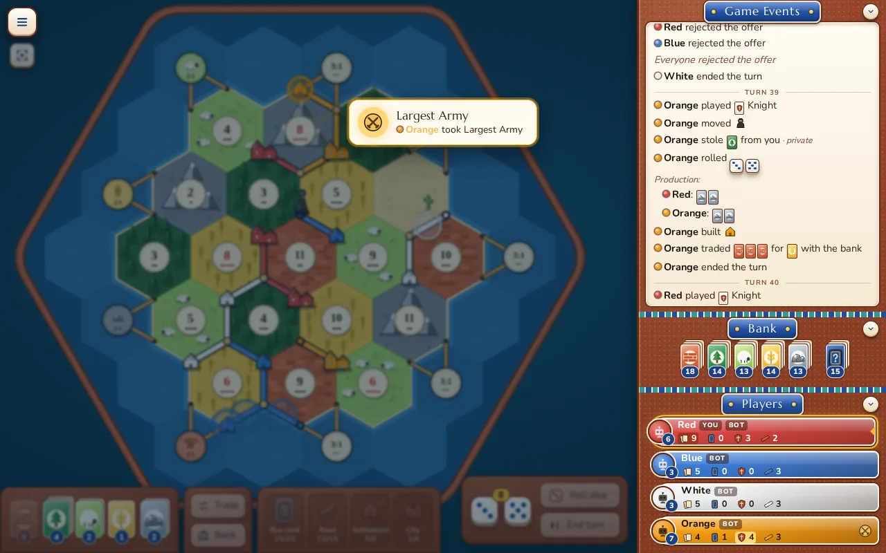
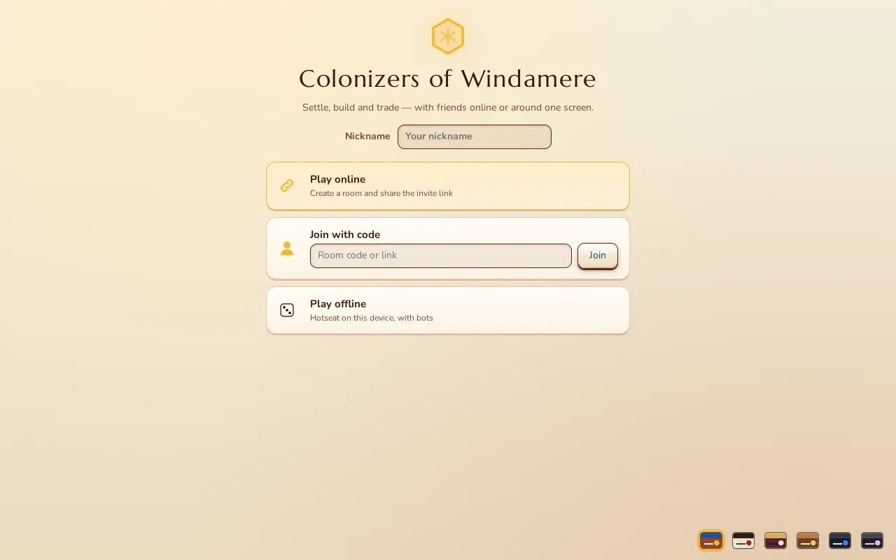

# Colonizers of Windamere

A browser Catan-style board game: settle, build and trade with friends online or around one screen, with bots to fill the seats.

**Play it: <https://colonizers-of-windamere.colonizers-of-windamere.workers.dev>**





## Features

- **Hotseat or online.** Create a room, share the invite link (nickname only, no accounts). Online play runs on Cloudflare Workers + Durable Objects: the server is authoritative, empty or disconnected seats are taken over by bots, and rooms have text chat, spectators and a server-enforced turn timer.
- **Bots** at Easy, Normal and Hard.
- **3–8 players.** Base boards for 3–4, 5–6 and 7–8 players; fixed, random or veto map selection.
- **Rule options.** Normal, friendly or no robber, turn clocks (Bullet to Classic, or custom), and setup variants.
- **Expansion modes**, all on the setup screen:
  - Seafarers (nine scenarios)
  - Cities & Knights
  - Traders & Barbarians (five scenarios and the variants, Catan for Two included)
  - Explorers & Pirates (Land Ho!, Pirate Lairs, Fish for Catan, Spices for Catan, full game)
  - Oil Springs
  - Crop Trust
- **Official combinations**: Seafarers + Cities & Knights, Traders & Barbarians + Cities & Knights, Traders & Barbarians + Seafarers, Traders & Barbarians scenario pairs, Explorers & Pirates + Cities & Knights, Explorers & Pirates + Fishermen, Barbarian Attack + Cities & Knights, Catan for Two + Cities & Knights.
- **Six themes** (Sunfired, Chartroom, Parlour, Wood, GitHub Dark, Material Dark), **sound effects**, production and award animations, build-cost tooltips.
- **Game statistics** screen: overview, dice, resources, activity, development cards, and trade stats by ratio.

Rules reference and per-rule engine status: [docs/RULES.md](docs/RULES.md).

## Run it locally

Prerequisites: Node 24 and pnpm 12 (the versions CI uses).

```sh
pnpm install
pnpm dev          # hotseat / bots at http://localhost:5173
pnpm dev:server   # build, then wrangler dev: the full Worker, for online play locally
```

Checks and tools:

```sh
pnpm typecheck
pnpm lint         # eslint + prettier --check
pnpm test         # vitest
pnpm sim          # headless bot-vs-bot games
pnpm e2e:server   # end-to-end test against the local room server
pnpm e2e:online   # two-browser online test (needs Chrome)
```

## Deploy your own copy

Static site plus room server, one Cloudflare Worker. After `npx wrangler login`, run `pnpm deploy:cf`. Steps, limits and rollback: [docs/HOSTING.md](docs/HOSTING.md).

## Project layout

| Path              | What                                                                        |
| ----------------- | --------------------------------------------------------------------------- |
| `src/engine/`     | Pure, deterministic rules engine (no DOM, no `Math.random`, no `Date`)      |
| `src/expansions/` | One folder per expansion or combination: engine rules, board art, HUD, bots |
| `src/bots/`       | Bot levels and the headless simulator                                       |
| `src/render/`     | PixiJS board view and hit-testing                                           |
| `src/ui/`         | HTML/CSS overlay: setup screen, HUD, stats, themes, online lobby            |
| `src/game/`       | Controllers wiring engine, render, UI and bots                              |
| `src/net/`        | Online protocol and client                                                  |
| `src/server/`     | Cloudflare Worker and the room Durable Object                               |
| `src/audio/`      | Synthesized sound effects                                                   |
| `scripts/`        | Screenshot scripts, e2e tests, playtest harness                             |

Docs: [ARCHITECTURE](docs/ARCHITECTURE.md) (the contract, read first), [EXPANSIONS](docs/EXPANSIONS.md), [MULTIPLAYER](docs/MULTIPLAYER.md), [ONLINE-CLIENT](docs/ONLINE-CLIENT.md), [HOSTING](docs/HOSTING.md), [RULES](docs/RULES.md).

## Contributing

Issues are welcome. Pull requests are squash-merged; before opening one, run `pnpm typecheck`, `pnpm lint` and `pnpm test`.

## License

The code is under the [GNU AGPL v3 or later](LICENSE). Anyone who runs a modified version as an online service must offer its source to that service's users. Third-party assets (fonts, packages) keep their own licenses; there is no separate credits file yet.

Unofficial fan project. Not affiliated with or endorsed by CATAN GmbH or Catan Studio. "Catan" is a trademark of its owners.
